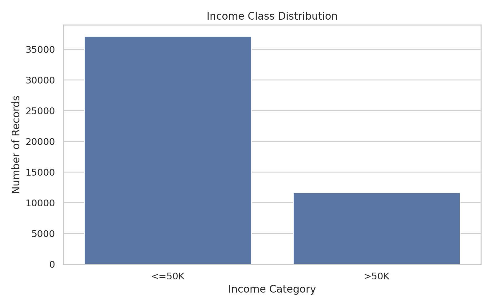
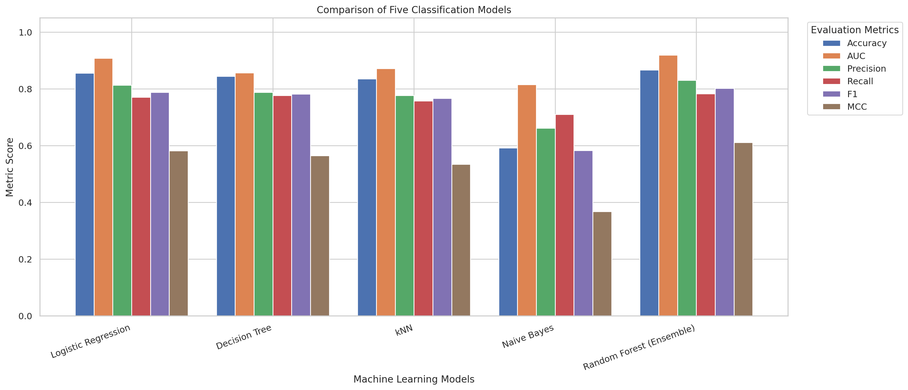
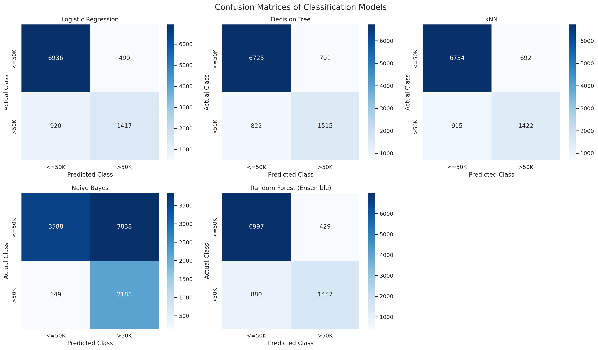
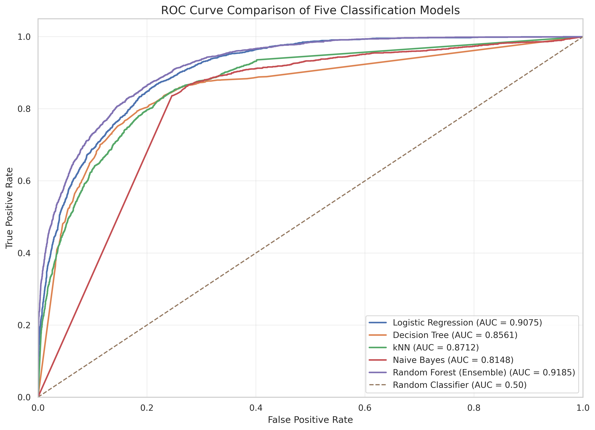
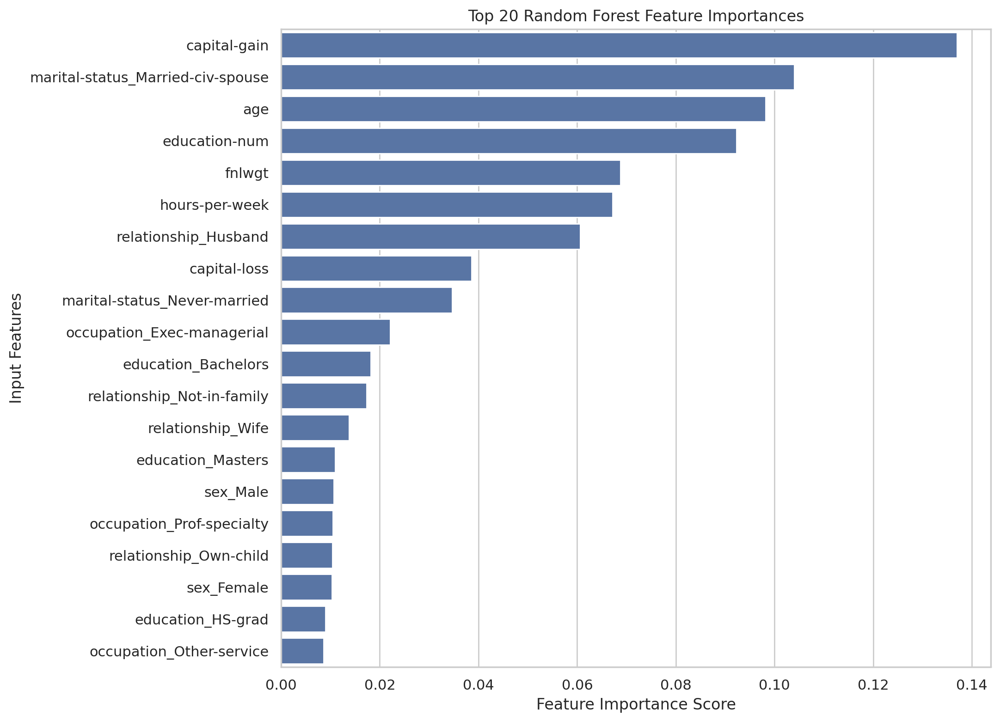
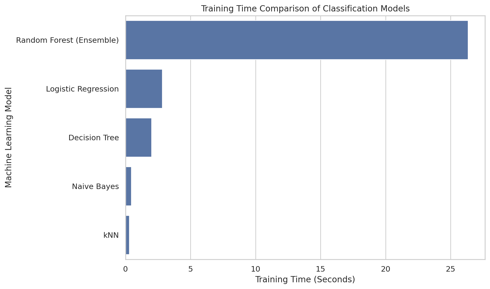
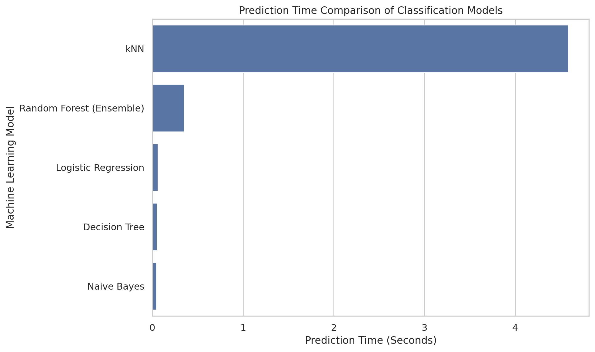

# MACHINE LEARNING ASSIGNMENT 2

**BITS Student ID:** 2026CT05193

**Programme:** M.Tech AIML

**Subject:** Machine Learning

## 1. Problem Statement

The objective of this project is to develop machine learning classification models to predict whether an individual's annual income exceeds $50,000 based on census-related information.

Five classification algorithms are implemented and compared using the same dataset.

The models are evaluated using Accuracy, AUC, Precision, Recall, F1 Score and Matthews Correlation Coefficient.

## 2. Dataset Description

**Dataset:** Adult Census Income Dataset

**Source:** UCI Machine Learning Repository

**Dataset Link:** https://archive.ics.uci.edu/dataset/2/adult

**Citation:** Becker, B. and Kohavi, R. (1996). Adult [Dataset]. UCI Machine Learning Repository. https://doi.org/10.24432/C5XW20.

**Original Records:** 48842

**Records after duplicate removal:** 48813

**Input Features:** 14

**Target Variable:** income

**Classification Type:** Binary Classification

**Classes:**
- 0: <=50K
- 1: >50K

### Dataset Selection Rationale

The dataset was selected because it contains a large number of observations, numerical and categorical variables, missing values and class imbalance.

It provides a suitable dataset for demonstrating preprocessing and comparing multiple classification algorithms.

### Feature Types

**Numerical Features:**

age, fnlwgt, education-num, capital-gain, capital-loss, hours-per-week

**Categorical Features:**

workclass, education, marital-status, occupation, relationship, race, sex, native-country

### Data Preprocessing

1. Identified missing values and converted question-mark placeholders into missing-value representations.
2. Identified and removed exact duplicate records.
3. Applied median imputation to numerical features.
4. Applied most-frequent imputation to categorical features.
5. Applied One-Hot Encoding to categorical features.
6. Applied StandardScaler to numerical features.
7. Used an 80:20 stratified train-test split.
8. Used random state 5193.
9. Fitted preprocessing pipelines using training data only to prevent data leakage.

## 3. GitHub Repository Link

https://github.com/2026ct05193/2026CT05193-Adult-Income-Classification

## 4. Models Used

The following five classification algorithms were implemented:

1. Logistic Regression
2. Decision Tree Classifier
3. K-Nearest Neighbors
4. Gaussian Naive Bayes
5. Random Forest Classifier (Ensemble)

### Model Configurations

- Logistic Regression: max_iter=2000
- Decision Tree: max_depth=20, min_samples_split=10
- KNN: n_neighbors=7, weights=distance
- Gaussian Naive Bayes: Default GaussianNB configuration
- Random Forest: n_estimators=200, max_depth=25, min_samples_split=5

### Model Comparison Table

| ML Model Name | Accuracy | AUC | Precision | Recall | F1 | MCC |
| --- | --- | --- | --- | --- | --- | --- |
| Logistic Regression | 0.8556 | 0.9075 | 0.8130 | 0.7702 | 0.7878 | 0.5816 |
| Decision Tree | 0.8440 | 0.8561 | 0.7874 | 0.7769 | 0.7819 | 0.5642 |
| kNN | 0.8354 | 0.8712 | 0.7765 | 0.7576 | 0.7662 | 0.5338 |
| Naive Bayes | 0.5916 | 0.8148 | 0.6616 | 0.7097 | 0.5830 | 0.3682 |
| Random Forest (Ensemble) | 0.8659 | 0.9185 | 0.8304 | 0.7828 | 0.8022 | 0.6114 |

### Graphical Representation

#### Class Distribution

#### Comparison of Evaluation Metrics

#### Confusion Matrices

#### ROC Curve Analysis

#### Random Forest Feature Importance

### Observations on Model Performance

| ML Model Name | Observation |
| --- | --- |
| Logistic Regression | Logistic Regression achieved an accuracy of 0.8556 and an AUC of 0.9075. Its macro precision was 0.8130, macro recall was 0.7702, macro F1 score was 0.7878, and MCC was 0.5816. The model's strongest metric was AUC, while its lowest metric was MCC. It correctly identified 93.40% of the actual <=50K class and 60.63% of the actual >50K class. |
| Decision Tree | Decision Tree achieved an accuracy of 0.8440 and an AUC of 0.8561. Its macro precision was 0.7874, macro recall was 0.7769, macro F1 score was 0.7819, and MCC was 0.5642. The model's strongest metric was AUC, while its lowest metric was MCC. It correctly identified 90.56% of the actual <=50K class and 64.83% of the actual >50K class. |
| kNN | kNN achieved an accuracy of 0.8354 and an AUC of 0.8712. Its macro precision was 0.7765, macro recall was 0.7576, macro F1 score was 0.7662, and MCC was 0.5338. The model's strongest metric was AUC, while its lowest metric was MCC. It correctly identified 90.68% of the actual <=50K class and 60.85% of the actual >50K class. |
| Naive Bayes | Naive Bayes achieved an accuracy of 0.5916 and an AUC of 0.8148. Its macro precision was 0.6616, macro recall was 0.7097, macro F1 score was 0.5830, and MCC was 0.3682. The model's strongest metric was AUC, while its lowest metric was MCC. It correctly identified 48.32% of the actual <=50K class and 93.62% of the actual >50K class. |
| Random Forest (Ensemble) | Random Forest (Ensemble) achieved an accuracy of 0.8659 and an AUC of 0.9185. Its macro precision was 0.8304, macro recall was 0.7828, macro F1 score was 0.8022, and MCC was 0.6114. The model's strongest metric was AUC, while its lowest metric was MCC. It correctly identified 94.22% of the actual <=50K class and 62.34% of the actual >50K class. |

### Overall Winner

**Selected Model: Random Forest (Ensemble)**

The winner was selected using Macro F1 Score as the primary criterion, followed by MCC, AUC and Accuracy.

### Computational Efficiency

| ML Model Name | Training Time (seconds) | Prediction Time (seconds) | Prediction Time (ms/record) |
| --- | --- | --- | --- |
| Logistic Regression | 2.8249 | 0.0592 | 0.0061 |
| Decision Tree | 2.0034 | 0.0505 | 0.0052 |
| kNN | 0.2980 | 4.5852 | 0.4697 |
| Naive Bayes | 0.4411 | 0.0435 | 0.0045 |
| Random Forest (Ensemble) | 26.3296 | 0.3512 | 0.0360 |

#### Training Time Comparison

#### Prediction Time Comparison

## 5. Execution Instructions

1. Open Google Colab.
2. Upload the project notebook.
3. Install the required packages using requirements.txt.
4. Run the notebook cells sequentially.
5. Verify the generated evaluation metrics and graphs.
6. Check the saved models and test data.

## 6. Project Files

- 2026CT05193_ML_Assignment_2.ipynb
- README.md
- requirements.txt
- test_data.csv
- model/
- outputs/

## 7. Conclusion

Five classification algorithms were implemented and evaluated using the UCI Adult Census Income dataset.

The experimental results were compared using six mandatory evaluation metrics.

Feature importance and computational efficiency were also analysed.

The model with the strongest Macro F1-based ranking was selected as the overall winner.
